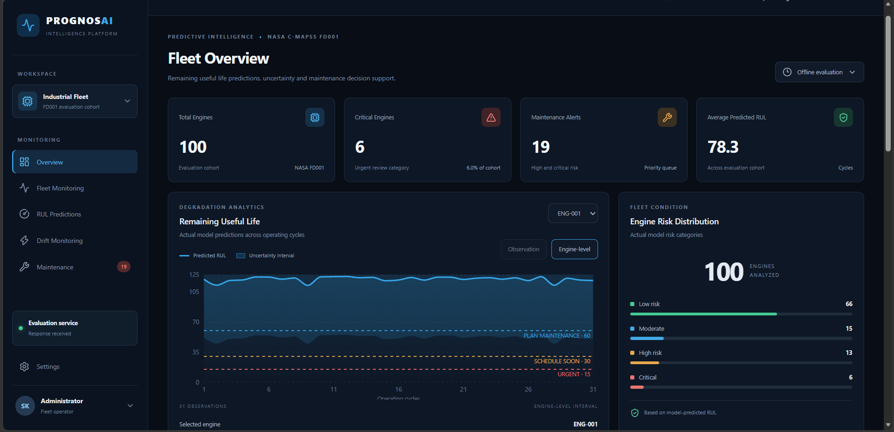
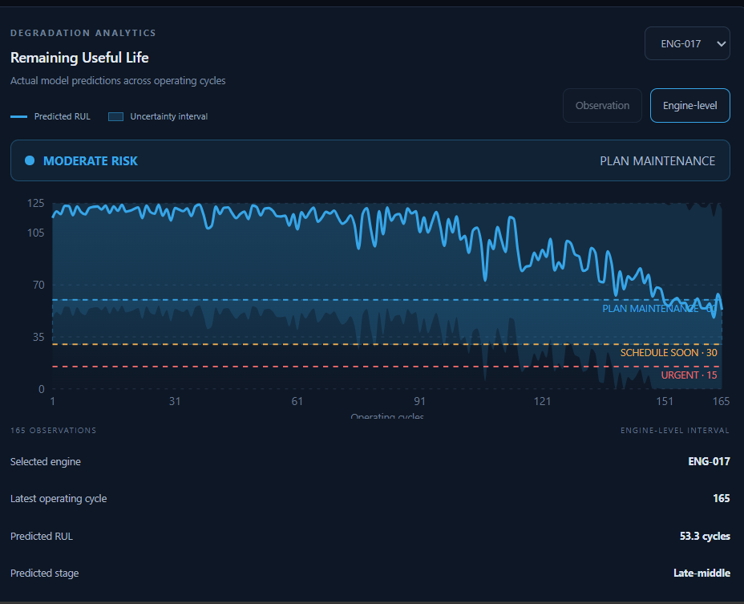
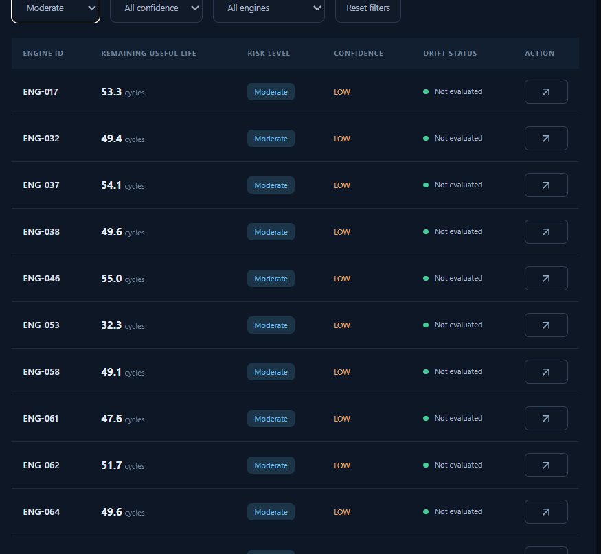

## System Architecture

The following diagram illustrates how data preprocessing, RUL prediction, uncertainty estimation, drift monitoring, and maintenance decision support work together.

For a detailed explanation of the components, see the [System Architecture Documentation](docs/architecture.md).

## Dashboard Preview

### Fleet Overview

### Engine Degradation Analytics

### Fleet Monitoring

