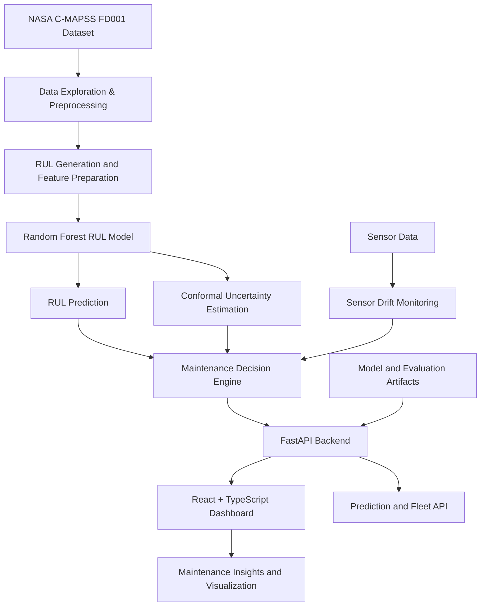

# PrognosAI — System Architecture

## Overview

PrognosAI is an uncertainty-aware predictive maintenance prototype. It uses the NASA C-MAPSS FD001 simulated turbofan dataset to estimate Remaining Useful Life (RUL), quantify prediction uncertainty, monitor sensor drift, and support maintenance decisions.

## Architecture Diagram

## Main Components

| Component        | Responsibility                                              |
| ---------------- | ----------------------------------------------------------- |
| Dataset          | Provides simulated turbofan engine degradation data         |
| Preprocessing    | Explores sensor data and prepares RUL labels                |
| ML Model         | Predicts Remaining Useful Life using Random Forest          |
| Uncertainty      | Estimates prediction intervals using conformal prediction   |
| Drift Monitoring | Checks sensor distribution changes                          |
| Decision Engine  | Converts model outputs into risk-based maintenance guidance |
| FastAPI          | Exposes prediction and fleet-related endpoints              |
| React Dashboard  | Presents predictions and maintenance insights               |

## Technology Stack

- **Machine Learning:** Python, NumPy, Pandas, SciPy, Scikit-learn
- **Model:** Random Forest
- **Uncertainty:** Conformal prediction
- **Monitoring:** Sensor drift analysis
- **Backend:** FastAPI, Uvicorn
- **Frontend:** React, TypeScript, Vite
- **Testing:** Pytest

## Important Limitation

The project is evaluated using simulated NASA C-MAPSS FD001 data. Its results should not be interpreted as proof of performance on real industrial machinery. Operational deployment would require validation using representative real-world equipment data.
